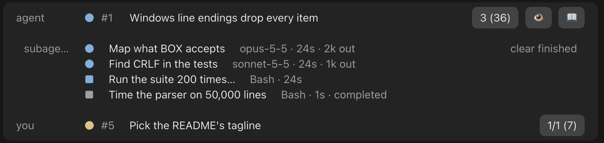
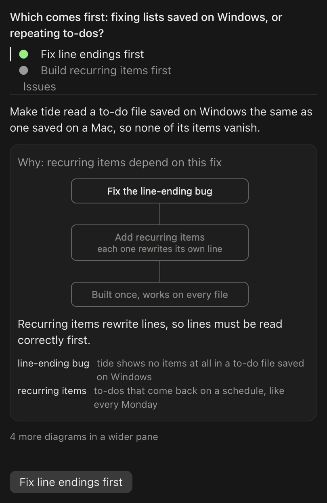
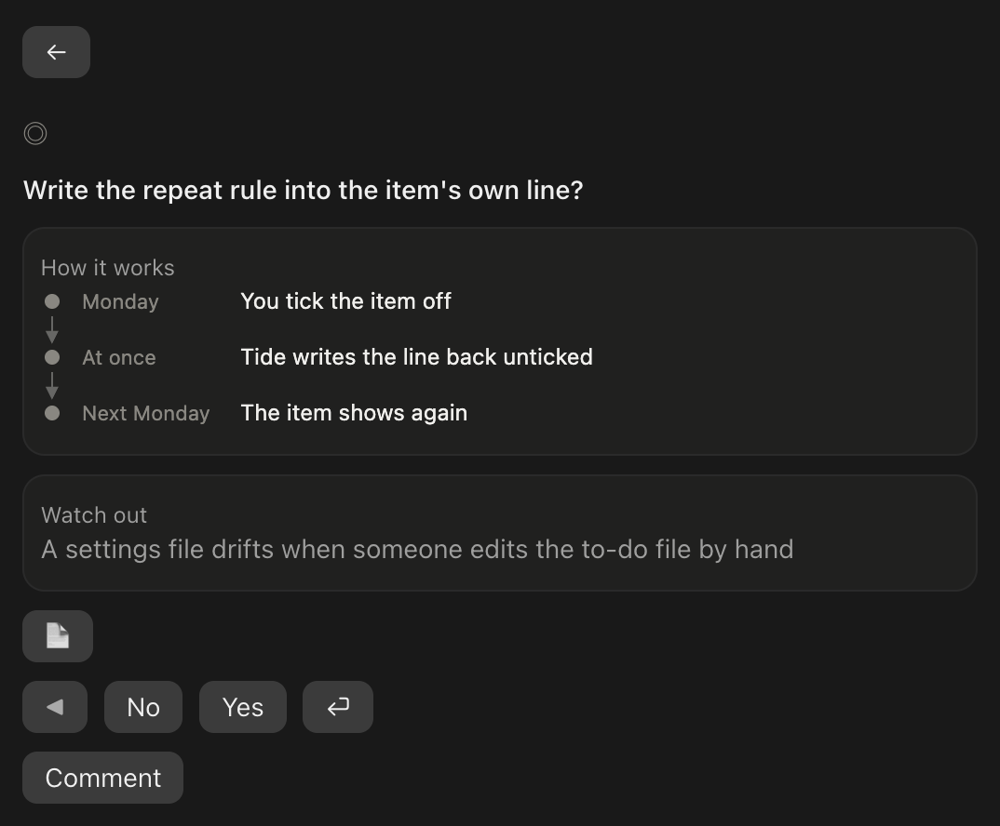

# Vantage Point

### See the work. Make the call.

A heads-up display for Claude Code. See what your agents are doing, turn their questions into clear choices, and answer what they need from you across your projects, without leaving the session you're in.

Claude Code desktop app · macOS and Windows · Open source · Early preview


## Install

You need the Claude Code desktop app on macOS or Windows; on Windows, also Git for Windows, which Claude Code recommends there for its Bash tool. Everything that reads GitHub (asks filed as issues, the counts and the frontier) also needs the GitHub CLI, `gh` 2.94.0 or newer, signed in.

In a terminal:

```bash
claude plugin marketplace add Leit-motif/claude-vantage-point
```

```bash
claude plugin install vantage-point@claude-vantage-point
```

Or, inside a Claude Code session, run `/plugin marketplace add Leit-motif/claude-vantage-point`, then `/plugin install vantage-point@claude-vantage-point`. Install at user scope so it also loads in the desktop app's Code tab.

Restart the app once, then run `/vantage-point tour` to try each feature on your own project ([about the tour](#see-it-in-action)).

## Everything important, within reach

As agents take on more of the work, your part moves to supervising it. Vantage Point doesn't run or plan that work. It shows you that work where you already look, above the prompt and beside the chat, and carries your decisions back.

### Stay on top of the work

The band tells you what is happening at a glance, so you don't have to dig through the transcript.



*Every agent, subagent and task, and what waits on you, above the prompt.*

- **What your agent is on.** The task it declared, or the issue its branch names, with its steps one press away.
- **What runs beneath it.** Every subagent, background task and session it starts, with each one's model, time, tokens and what it is doing now.
- **What waits on you.** This project's next ask, and how many wait across your repositories.
- **Where the project stands.** One press opens the frontier: this repository's open issues, sorted into what waits on you, what is blocked, and what is next.
- **What changed.** Turn on the session banner to see each file this session edited, with its lines added and removed, linked to the decision record it answers to.

### Turn questions into decisions

When a reply ends by asking you to choose, its options appear on one line above the prompt, the recommended one in green. Press one to answer with it.

To weigh them first, open the decision deck beside the chat. It has a tab for each option and opens on the recommended one.



*Each option makes its case on a page of its own, and one button sends it.*

Widen the pane and the page shows the rest of its diagrams: how the option works, who does the work, and what could go wrong, with the fallback. The recommended answer also waits in the empty prompt box, where Tab takes it.

### Keep the human bottleneck moving

Agents often need something only you can give: a judgment, an approval, a step they can't take themselves. They leave it as an ask, in `human-queue.md` at the project root or as an issue in one of your GitHub repositories, and every ask gathers in one queue, grouped by repository.



*An ask you can answer on its own: the question, its context in pictures, Yes or No.*

A card holds at most two pictures, and a comment can go with your Yes or No. A task only you can do arrives as a to-do: mark it done, or hand it to an agent.

Submit in the session that asked, and its agent gets your rulings straight back and carries on.

## A few extras

### Read differently

📖 plays a long reply one word at a time, each word held on a fixed point by its red anchor letter, so your eyes stay still while the text moves. It plays the agent's short gist first when it wrote one, with the whole reply one press away. The transcript goes dark while it reads.

### Make the most of your prompt caches

The footer shows how long this session's prompt cache stays warm. Its pill opens every warm cache on your machine, with its size, hit rate and minutes left. A warm cache keeps the next turn fast and cheap; once it goes cold, that turn pays for the whole context again.

When you step away, **Keep warm** keeps an armed session's cache warm for up to 6 hours after you last acted on it, or until midnight if that comes first.

## See it in action

Run `/vantage-point tour`, or ask your agent to open the Vantage Point tour. A fresh install points you there once.

The tour first checks your setup: your system, `gh`'s version and sign-in, whether this folder has a `human-queue.md`, and which conventions Vantage Point reads your workflow by. Then it lists each feature with a button. The first, **Your workflow**, reads this repository's labels, branch names and decision-record folders, and files anything Vantage Point would read differently as an ask in your queue; nothing is written until you rule.

Each **Try** sends this session's agent a short prompt, so the feature runs for real on your own project: subagents fan out, a reply ends on a choice and the deck fills, an ask lands in your queue, a long reply plays in the reader. Caches has **Open** instead, which opens its pane. Each Try costs a few turns of your usual usage. Nothing else in the tour sends anything.

## Data, permissions, and usage

Vantage Point runs inside Claude Code on your machine. It has no server of its own and needs no API key.

- **On your machine.** It reads Claude Code's transcripts under `~/.claude/projects` and the desktop app's session files, for the caches and the subagents row; your repository's git state and history and its decision records, for the agent row and the banner; its conventions files and yours, for how it reads your workflow; and `human-queue.md`. It writes your rulings into `human-queue.md`, keeps a cache of ask pictures, and writes a conventions file only with the fields you rule yes. None of this leaves your machine.
- **From GitHub, through `gh`.** Open issues, with their labels, bodies and comments, in the repositories of the account `gh` is signed in as: this repository's for the frontier, every repository's asks and ready work for the counts, and a repository's conventions files when you act on one of its issues.
- **From the web.** Pictures an ask links to, fetched from their links; GitHub uploads go through `gh`.
- **To GitHub.** Vantage Point writes only when you act on an issue in the queue. Submitting rulings posts them as one comment and changes the issue's label so it stops waiting on you. On a to-do, **Done** closes the issue and **Hand to agent** relabels it for an agent; Undo takes either back. Without `gh`, asks in `human-queue.md` still work.
- **Claude usage.** Every model call runs on your Claude Code session's own access:
  - *The decision deck.* On each reply that looks like a choice, a Haiku call checks that it is one, a fork of the session writes the deck from its prompt cache, and Haiku shortens any text too long for its place. There is no setting to turn this off yet.
  - *Rulings.* Handing your rulings back starts a turn for the agent that asked. When that session's cache has gone cold with a large context, a fresh agent takes them instead and does the follow-up work they unblock in your repository.
  - *Keep warm.* A short ping before each expiry while a session is armed. Off until you arm it.
  - *The tour.* Each Try.
- **Your agent's instructions.** It adds a line to the system prompt asking agents to declare their task with the `task` tool, and, on a branch that names an issue, says which issue that is. With the `readerGist` setting on, the default, another line asks them to end a long reply with a short gist.
- **The app's own prompts.** When your agent asks you a multiple-choice question, in the app's dialog or its wrap-up box, the question moves to the reply row. While a phone is attached through Remote Control, a permission prompt also asks on the reply row, with Allow once and Deny. In the desktop app the band shows the agent's task list in place of the app's own; `/vantage-point steps` gives it back.

## Compatibility and limitations

- **macOS and Windows.** On Windows a picture on a card draws only when it is small and not tall, else Open shows it, and a video's Play button shows no length: macOS's image and audio tools, which shrink a picture and read a film's length, have no Windows counterpart. Without Git for Windows, pictures and the caches of long sessions do not load.
- **Drawn in the desktop app.** The band, panes and reader draw in the desktop app's Code tab. Cloud sessions on claude.ai draw no mods.
- **Early preview.** Vantage Point is 0.x, so its formats may still change, and Claude Code's mod API is early access and changes between releases.
- **Your workflow, as it is.** Vantage Point reads Matt Pocock's triage labels and follows his states, under your repository's own names when its `docs/agents/triage-labels.md` renames them, and never changes that setup. Where your repository works differently, with other labels, branch names or decision-record folders, the tour's **Your workflow** stop proposes the difference for you to rule on ([conventions](#conventions)).
- **Your own repositories.** Asks and counts come only from repositories the signed-in `gh` account owns. Organization repositories stay out by design, for trust and to stay within GitHub's search limits; the frontier still works inside one.
- **Keep warm needs the session running.** A session can only refresh its own cache, so Keep warm holds while the desktop app runs that session.
- **One band.** Another mod that draws above the prompt may take its place.

## Reference

### Commands

| Command | Does |
|---|---|
| `/vantage-point` | Opens the queue |
| `/vantage-point tour` | Opens the tour |
| `/vantage-point caches` | Opens the Caches pane |
| `/vantage-point keep-warm` | Arms or disarms Keep warm for this session |
| `/vantage-point steps` | Gives the task list back to the app, or takes it again |
| `/vantage-point banner` | Shows or hides the session banner |

### The band, row by row

- **Reply row.** A reply's options on one line, the recommended one green. Press an option to send it; press the headline to open the decision deck.
- **Agent row.** The task the agent declared with the `task` tool, or the issue its branch names (by default `<word>/<n>-<slug>` or `<word>/<n>`, such as `issue/12-fix`). Press the title for its steps. The pill counts this repository's issues ready for an agent, then every repository's in parentheses when that differs (`2 (8)`). Press it for the frontier: **This repository** lists what waits on you, what is blocked and the next three, and counts the rest, an issue no label places among them; **All repositories** lists every repository's asks and work ready for an agent. Each issue is one press from its page. Outside a GitHub repository, the pill counts and opens every repository's. 📖 at the right opens the reader.
- **Subagents row.** Counts, then each subagent, background task and desktop session this one started, with its model, time, tokens and what it is doing now. Press a session's title to open it.
- **Session banner.** 👁️ beside 📖 shows a strip above the rows: each file this session edited, with the lines it gained and lost, linked to the decision record (ADR) it answers to, in `docs/adr` or `docs/decisions` by default. Off until you press it.
- **Your row.** This project's next ask, and how many wait on you across your repositories. Press it to open the queue.

### The queue

An ask filed as an issue is an open issue labelled `ready-for-human`, or your repository's name for that label, with its items under a `## Asks` heading, the format the bundled `vantage-point:ask` skill teaches, shown in [`examples/human-queue.md`](examples/human-queue.md). Its asks count only when your own `gh` account wrote them, so a stranger's issue on a public repository never becomes a decision card.

The queue opens on an overview of every ask, grouped by repository. On a card:

| Control | Does |
|---|---|
| **Yes** / **No** | Rules the item, then moves to the next one |
| ◀ / ▶ | Back to an earlier item, or on to the next |
| ⏎ | Submit, in ▶'s place on the last item; white once every item is ruled |
| **Comment** | Opens a field under it. Enter or Save keeps the comment, Cancel drops it |
| 📄 / ⤢ | The item's full text, or a picture at full size |
| ← | Back to the overview, where Undo takes back what you last did, and Redo puts it back |

A pair item shows two outputs in a blind order, ruled A, B or Same.

An issue waiting on you with no asks shows as a to-do card: its title, then from its triage brief why it needs a person and the acceptance criteria, or with no brief the opening of its body. **Done** closes it; **Hand to agent** swaps `ready-for-human` for `ready-for-agent`, in your repository's names. Undo takes either back, and both act only in repositories your `gh` account owns.

Wherever you submit, your rulings are recorded where the ask lives: as one comment on the issue, or in `human-queue.md`. On an issue, the label changes too, by the repository's `afterRulings` convention: `ready` swaps `ready-for-human` for `ready-for-agent`, and `unlabel` takes `ready-for-human` off. Unset, a repository with `docs/agents/triage-labels.md` swaps and any other removes. If you submitted in the session that asked, its agent also gets the rulings as JSON. It takes them itself while its cache is warm or holds 200k tokens or fewer; otherwise a fresh agent beside it takes them.

### Conventions

Vantage Point reads each repository's workflow from its conventions. Each field comes from the first of these that sets it: the repository's `.claude/vantage-point.json`; its `docs/agents/triage-labels.md`, for the role labels only; your own `~/.claude/vantage-point.json`, for every repository you open; then Matt Pocock's defaults.

| Field | Holds | Default |
|---|---|---|
| `roles` | The label for each triage role: waiting, ready, triage, info, parked | `ready-for-human`, `ready-for-agent`, `needs-triage`, `needs-info`, `wontfix` |
| `labels` | Further labels, each with the frontier state it places an issue in and an optional stage name | None |
| `branches` | The branch forms that name an issue, `{n}` for its number and `*` for any run | `*/{n}-*`, `*/{n}` |
| `adrDirs` | The folders that hold decision records | `docs/adr`, `docs/decisions` |
| `parent` | The links that name a parent issue: `native` sub-issues, `part-of` lines | Both |
| `tracker` | `github`, `gitlab` or `local`; only `github` reads issues | `github` |
| `afterRulings` | What submitting rulings does to the waiting label: `ready` swaps it, `unlabel` removes it | `ready` with `docs/agents/triage-labels.md`, else `unlabel` |

A field that fails its check falls back to the next source, and the tour names it. The bundled `vantage-point:set-conventions` skill, which the tour's **Your workflow** stop runs, proposes only what differs from what Vantage Point reads now and writes only the fields you rule yes. `node --experimental-strip-types scripts/conventions.mts read` (Node 22.6 or newer) prints the conventions in force and where each field came from.

### The reader

It plays the agent's gist first when the reply has one, then the whole reply on a press. The `readerGist` plugin setting, on by default, asks agents for that gist; with it off, that line leaves the system prompt and the reader plays the full reply. Speed moves in steps of 50 words a minute, from 200 to 800.

### Caches and Keep warm

The footer's label reads like `Cache 48m`, green while warm; its pill opens the Caches pane. Keep warm pings an armed session shortly before each expiry: 3 minutes before for a 1-hour cache, 30 seconds before for a 5-minute one. It stops 6 hours after you last acted on the session, at local midnight, or as soon as a ping misses the cache.

### How often it reads

GitHub about once a minute, through `gh`'s cache so open sessions share one read; transcripts every 15 seconds; the session banner's git history at most every 10 minutes a repository.

### How it's built

Vantage Point is a Claude Code mod: a plugin whose hooks draw in the desktop app. `hooks/register.tsx` mounts the band and the panes and registers the tools and `/vantage-point`. The logic they draw from is pure and lives under `panes/`: the queue's format in `panes/human-queue/queue.ts`, the reader in `panes/reader/`, the caches in `panes/caches/`. The contract agents follow to ask is `skills/human-queue/SKILL.md`.

## Development

```bash
claude plugin validate .
```

```bash
claude --plugin-dir .
```

The mod API is early and changes between Claude Code releases; the engine lays its types in `.claude-plugin/types/` at load. Issues and ideas are welcome.

## License

MIT
