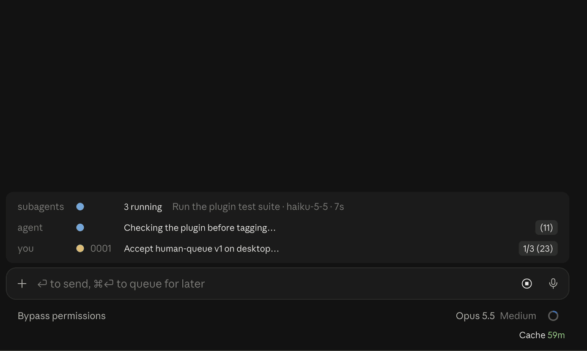

# Vantage Point

A heads-up display for Claude Code. It shows what your agent is doing above the prompt, lays out a decision when a reply asks you to choose, plays long replies one word at a time, tracks every warm prompt cache on your machine, and gives your agents a queue of asks you rule on with yes or no.



It is a Claude Code **mod**: a plugin that draws in the desktop app. It is an early preview (0.x), so its formats may still change.

## Install

In a terminal:

```bash
claude plugin marketplace add Leit-motif/claude-vantage-point
```

```bash
claude plugin install vantage-point@claude-vantage-point
```

Or inside a Claude Code session: `/plugin marketplace add Leit-motif/claude-vantage-point`, then `/plugin install vantage-point@claude-vantage-point`, at user scope. A plugin installed at user scope also loads in the desktop app's Code tab. Restart the app once so it loads.

## Start with the tour

Run `/vantage-point tour`, or ask your agent to "open the Vantage Point tour". The tour pane checks your setup, then lists every feature with a button:

- **Try** sends this session's agent a short prompt, so the feature runs for real on your own project: subagents fan out, a reply ends on a choice and the deck fills, an ask lands in the queue, a long reply plays in the reader.
- **Open** opens the caches pane.

Each Try costs a few turns of your usual usage. Nothing else in the tour sends anything.

## What it draws

**The band**, above the prompt, one row per thing worth a glance:

- **Reply row.** When a reply ends by asking you to choose, its options sit on one line, the recommended one green. Press an option to answer with it; press the headline to open the decision deck.
- **Agent row.** What the agent is on: the task it declared with the `task` tool, or the issue its branch names (`issue/<n>-…`). Press the title for its steps. The pill counts this repository's issues ready for an agent, then every repository's in parentheses when that differs (`2 (8)`). Press it for this repository's frontier: every ask **Waiting on you**, everything **Blocked**, the **Next** three, and the rest counted, each issue one press from its page, with **All repositories** one press away in the same pane: every repository's asks and work ready for an agent. It reads Matt Pocock's triage labels, renamed by your `docs/agents/triage-labels.md` if you have one, and counts an issue no label places rather than hiding it. 📖 at the right opens the reader.
- **Subagents row.** Every subagent this session starts, its background tasks, and the sessions it starts in the desktop app: counts, then each one's model, time, tokens and what it is doing now. Press a session's title to open it.
- **Session banner.** 👁️ beside 📖 shows a strip above the rows: each file this session edited, with the lines it gained and lost, linked to the decision record (ADR) in `docs/adr` or `docs/decisions` it answers to. Off until you press it.
- **Your row.** This project's next ask, and how many wait on you across your repositories. Press it to open the queue.

**The decision deck**, beside the chat: the question, then a tab per option, opening on the recommended one. Each tab is one page with no scroll: what the option is, then diagrams that make its case (why, how it works with its terms explained, who does the work, what could go wrong and the fallback), then a button named for the option, which sends it as your reply.

**The RSVP reader.** Plays the reply's gist, then optionally the whole reply, one word at a time with a red anchor letter on a fixed focal point. The transcript goes dark while it reads. Speed steps of 50 words a minute.

**The cache label and the Caches pane.** The footer shows this session's prompt cache, `Cache 48m`, green while warm. Its pill opens every warm cache on this machine, with each one's size, hit rate and minutes left. **Keep warm** pings an armed session while you are away, until 6 hours after your last turn or midnight.

**The human queue.** Agents leave asks in `human-queue.md` at the project root, or as GitHub issues labelled `ready-for-human`. The queue pane opens on an overview of every ask, grouped by repository. Each ask is a card: the question, at most two pictures, then the controls:

| Control | Does |
|---|---|
| **Yes** / **No** | Rules the item, then moves to the next one |
| ◀ / ▶ | Back to an earlier item, or on to the next |
| ⏎ | Submit, in ▶'s place on the last item; white once every item is ruled |
| **Comment** | Opens a field under it. Enter or Save keeps the comment, Cancel drops it |
| 📄 / ⤢ | The item's full text, or a picture at full size |
| ← | Back to the overview, where Undo takes back what you last did, and Redo puts it back |

The pane binds no letter keys, so typing always goes to the chat. The asking agent gets your rulings back as JSON; for an issue, they post as one comment. Agents learn the format from the bundled `vantage-point:ask` skill; an example is in `examples/human-queue.md`.

## What it runs, reads and sends

- **GitHub, through your `gh`.** Once a minute it reads the open issues labelled `ready-for-human` and `ready-for-agent` in the repositories of the account `gh` is signed in as. It posts only when you submit rulings on an issue: one comment, then it removes the label. Without `gh`, `human-queue.md` still works and the tour says what is missing.
- **Your transcripts, locally.** The Caches pane reads Claude Code's own transcripts under `~/.claude/projects` every 15 seconds, and the desktop app's session files, which say which session started which; the subagents row reads the same to list the sessions this one started. Nothing leaves the machine.
- **Model calls on your session's access, no API key.** When a reply asks you to choose, a Haiku call checks it really needs a decision, then a fork of the session (served from its prompt cache) writes the deck, and Haiku checks each sentence against its quotes.
- **Your git history, locally.** For the session banner it runs `git rev-parse` and `git log` in the repository of each file an agent edits, at most every 10 minutes a repository, and reads its ADRs. Nothing leaves the machine.
- **Keep warm sends prompts.** While a session is armed it sends a short ping when its cache is about to go cold. It spends usage; it is off until you press it.
- **The system prompt.** It adds a line asking agents to call the `task` tool, and, with the `readerGist` setting on, to end a long reply with a short gist.
- **The task list.** In the desktop app the band shows the agent's task list in place of the app's own; `/vantage-point steps` gives it back to the app.

## Good to know

- **The band is shared.** Another mod that draws above the prompt may take its place.
- **Desktop first.** The band, panes and reader are drawn for the Claude Code desktop app. Cloud sessions on claude.ai draw no mods.
- **Commands.** `/vantage-point` opens the queue; `tour`, `caches`, `keep-warm`, `steps` and `banner` follow it.

## Development

```bash
claude plugin validate .
```

```bash
claude --plugin-dir .
```

The mod API is early and changes between Claude Code releases; the engine lays its types in `.claude-plugin/types/` at load. Issues and ideas are welcome.

## License

MIT
